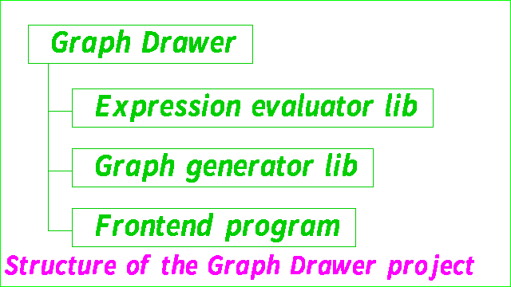
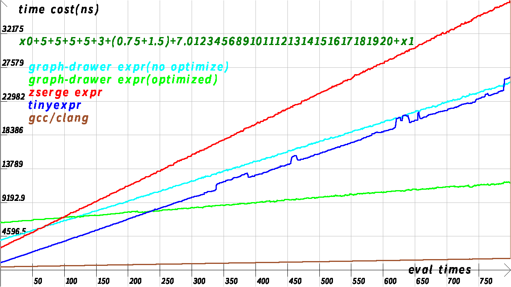

# Graph Drawer

[](https://github.com/ksd1000/graph-drawer/actions/workflows/ci.yml)
[](https://doi.org/10.5281/zenodo.23488030)

This is a product able to parse expressions and generate image and audio, with two backend libraries, an expression evaluator and a graph drawing library.

## Project Structure



## Expression Evaluator: libexpr,libexpr-lc

The libexpr is freestanding library able to parse and eval the input expression and return the result to the caller, without libc.

The libexpr-lc provides the constants such as e,pi and the standard libc functions such as sin(),exp(), but libc is required by libexpr-lc.

- Can add custom variable,constant and function.
- Can use custom memory allocator.
- MT-safe if a struct expr object is for only a thread and the memory allocator is MT-safe.
- Reentrant if the memory allocator is.

Suitable for:
- Parse expression once with eval many times.
- Requires branch and loop in expression.

Not suitable for:
- Parse simple expression once with eval only several times.
- The expression evaluator behaves worse(and may be forever worse) than [tinyexpr](https://github.com/codeplea/tinyexpr) in the cases like this. See the below.



*Test on x86*
```
./speedtest -n 800 -a 8192 -ocurve.bmp
```

The library does not depend on the other parts of Graph Drawer. So it can also be used like a **standalone library**(though it is not) for other programs, for runtime expression parsing without building the libgraph and frontend. By the command:
```
cd expr
cmake -B expr-build -DCMAKE_BUILD_TYPE=Release
cd expr-build
cmake --build .
```
Only libexpr,libexpr-lc,expr-version,expr-check will be generated by this way.

**Core API:**
```C
struct expr *expr_new(const char *e,const char *asym,struct expr_symset *esp,int flag,int *error,char errinfo[EXPR_SYMLEN]);
int expr_init(struct expr *restrict ep,const char *e,const char *asym,struct expr_symset *esp,int flag);
double expr_eval(const struct expr *ep,double input);
void expr_free(struct expr *ep);
double expr_calc(const char *e);
```
Note that the expr\_new(),expr\_init() and expr\_calc() are just marcos in current version, the functions be called are actually expr\_new9\_r(),expr\_init8\_r() and expr\_calc5\_r() with the default memory allocator(malloc(),realloc(),free()).

## Graph Generator: libgraph

The libgraph is able to generate the image of a function. But it supports only .bmp format now. libc is required by libgraph.

## Build guide

```
cmake -B build -DCMAKE_BUILD_TYPE=Release
cd build
cmake --build .
```

## Example

draw a graph of sin(t) to 1.bmp:
```
./draw -o 1.bmp 'sin(t)'
```

output the sum from 1 to 100:
```
./calc 'sum(n,1,100,1,n)'
```

Show how the expression evaluator works:
```
./calc -Dkd 'sin(t)+1/2+3'
```
output:
```
={
1     0:[0]->[0] input [0]
1     1:[0]->[1] call  [0]    sin
1     2:[0]->[2] add   [0]    [1]=3.5
1     3:[0]->[3] end   [0]
}
```

```
./calc -Dkdn 'sin(t)+1/2+3'
```
output:
```
={
1     0:[0]->[0] input [0]
1     1:[0]->[1] call  [0]    sin
1     2:[0]->[2] const [1]    1
1     3:[0]->[3] const [2]    2
1     4:[0]->[4] const [3]    3
1     5:[0]->[5] div   [1]    [2]
1     6:[0]->[6] add   [0]    [1]
1     7:[0]->[7] add   [0]    [3]
1     8:[0]->[8] end   [0]
}
```

generate a 1s 440Hz sound .wav file:
```
./wave 'sin(440*2*pi*t)' -c 1 -o 1.wav
```

An example of API of graph-drawer expr:
```C
#define _GNU_SOURCE
#include <stdio.h>
#include <stdlib.h>
#include <assert.h>
#include "expr.h"
expr_globals_define();
// Remove if libexpr-lc is linked.
int main(void){
	struct expr *ep;
	ep=expr_new2("t+1","t");
	assert(ep);
	printf("result:%lf\n",expr_eval(ep,2.0));
	expr_free(ep);
	return EXIT_SUCCESS;
}
```

Add custom variable and function:
```C
#define _GNU_SOURCE
#include <stdio.h>
#include <stdlib.h>
#include <assert.h>
#include "expr.h"
expr_globals_define();
// Remove if libexpr-lc is linked.
double mul3add1(double x){
	return x*3.0+1.0;
}
int main(void){
	struct expr *ep;
	struct expr_symset *esp;
	volatile double x0=4.0;
	esp=expr_symset_new();
	assert(esp);
	assert(expr_symset_add(esp,"x0",EXPR_VARIABLE,0,&x0));
	assert(expr_symset_add(esp,"f",EXPR_FUNCTION,0,mul3add1));
	ep=expr_new4("t+1+x0+f(x0)","t",esp,0);
	assert(ep);
	printf("x0=%lf,result:%lf\n",x0,expr_eval(ep,2.0));
	x0=2.0;
	printf("x0=%lf,result:%lf\n",x0,expr_eval(ep,2.0));
	expr_free(ep);
	expr_symset_free(esp);
	return EXIT_SUCCESS;
}
```

Use only the memory of stack to parse and eval expression.
```C
#define _GNU_SOURCE
#include <stdio.h>
#include <stdlib.h>
#include <assert.h>
#include "expr.h"
int main(void){
	char buf[8192];
	struct expr *ep;
	struct expr_memtool mtl;
	assert(!expr_setup_heapmtl(&mtl,buf,8192));
	ep=expr_new2_r("t+1","t",&mtl);
	assert(ep);
	printf("result:%lf\n",expr_eval(ep,2.0));
	//expr_free() is not necessary here.
	return EXIT_SUCCESS;
}
```
compile command (assuming the code is written to example.c in the build path):
```
gcc example.c -I ../graph-drawer/expr expr/libexpr.a -o example -Wall -Wextra
```

Use function in libc math.h:
```C
#define _GNU_SOURCE
#include <stdio.h>
#include <stdlib.h>
#include <assert.h>
#include "expr.h"
int main(void){
	struct expr *ep;
	struct expr_symset *esp;
	esp=expr_symset_new();
	assert(esp);
	expr_builtin_symbol_addall(esp,expr_symbols_default);
	ep=expr_new4("sin(t)","t",esp,0);
	assert(ep);
	printf("result:%lf\n",expr_eval(ep,1.0));
	expr_free(ep);
	expr_symset_free(esp);
	return EXIT_SUCCESS;
}
```

compile command (assuming the code is written to example.c in the build path):
```
gcc example.c -I ../graph-drawer/expr expr/libexpr-lc.a expr/libexpr.a -lm -o example -Wall -Wextra
```

## Speed
About 2610% slower than native C.
Tested by test/speedtest.c

## Compare with other expr libs

||zserge expr|tinyexpr|graph-drawer expr|gcc/clang|
|:---:|:---:|:---:|:---:|:---:|
|Support data type|float|double|double|all of C|
|Expression object type|struct expr|te\_expr|struct expr|asm|
|Namespace|expr\_|te\_|expr\_|\-|
|Constructor|expr\_create()|te\_compile()|expr\_init()|main()|
|Destructor|expr\_destroy()|te\_free()|expr\_free()|exit()|
|Initialize/Parse speed|Medium 2.3x|Fast 8.6x|Slow 1.0x|\-|
|Evaluate speed|Slow 1.0x|Medium 1.7x|Medium 2.3x|Fast 27.1x|
|Memory cost|Medium 1.2x|Low 1.0x|High 3.8x|\-|
|Bitwise and/or/xor support|Cast to integer|No|Yes|Integer only|
|Action on fail|NULL+leak|NULL+errcode|-1/NULL+errcode+errstring|output error|
|Number parse|Digit accumulate|Digit accumulate|Pseudo strtod|\-|
|Number parse speed|Fast-Medium|Fast|Slow|\-|
|Number parse precision|1\*10^-6|0~1 ULP|0|0|
|Number parse cache|No|No|Yes(but still slower than other two)|\-|
|libc required|Yes|Yes|No for core. But builtin symbols and frontend needs.|\-|
|Core arch independence|Yes|Yes|x86/arm64 for mem* and syscall|\-|
|Non-unix support|Untested|Yes(tested by CI)|Yes(\*.exe in Release)|\-|
|User variable defined in code|Yes|Yes|Yes|Yes|
|Memory management|libc|libc|struct expr\_area|\-|
|Memory allocation entry|calloc()|malloc()|mtl-\>allocate()|\-|
|User variable defined in expr|Yes(Auto)|No|Yes(value--\>a/a=:value/var(a,[value]))|Yes|
|Allow write variables in expr|Yes(=)|No|Yes(--\>,-\>)|Yes|
|User constant|No|No(only zero args pure function)|Yes|Yes|
|Active|No (Latest 2017-12-3)|Yes|Yes|Yes|
|Amount of bugs|Few-Medium|Few|Many|\-|
|Size|Lightweight|Lightweight|Bloated|Giant|
|Allow unsafe mode|No|No|Yes|Yes|
|Gnu extension required|No (C99)|No (C99)|Yes|Yes|
|Power operator|\*\*|^|\*\*|\-|
|Amount of file|Single header file|Single .c file+header|Multi-file|\-|
|Hot function|Yes|No|Yes|\-|
|Optimize|No|Yes|Yes|Yes|
|Parse output|AST|AST|struct expr\_inst[]|asm|
|Symbol system|struct expr\_var\_list(one-next list)/struct expr\_func(array)|te\_variable(array)|struct expr\_symset(multi-next list)/struct expr\_builtin\_symbol(array)|\-|
|Symbol create API|expr\_var()|No|expr\_symset\_add()|\-|
|Eval API|expr\_eval()|te\_eval()|expr\_eval()|func()|
|One-shot API|No|te\_interp()|expr\_calc()|\-|
|Custom memory allocator|Yes(global variable required,patch before header)|Yes(global variable required,patch before header)|Yes(global+non-global)|\-|
|MT-safe for same object|Yes(except = and context)|Yes|No(an object only for one thread)|\-|
|Reentrant|No(allocate/free require global variable)|No(similarly)|Yes(\*\_r)|\-|
|JIT support|Yes|No|No|Always|
|Recursion limit|No|Yes(hard-coded)|Yes|\-|
|Branch and loop|No|No|Yes|Yes|
|Syscall support|No|No|Yes|Yes|
|AST support|Yes|Yes|No|\-|
|Can run in kernel|No|No|[Yes](fun/kmod/README.md)|No(Product Yes)|
|Can run in raw QEMU|No|No|Untested|No(Product maybe YES)|
|Big-endian support|Yes|Yes|No|Yes|
|Compile speed of source code(.c)|Fast|Fast|Slow|Very slow|
|Library size(-O3)|18k|20k|350k(196k+154k)|\-|
|Library size(-Os)|17k|18k|305k(153k+152k)|\-|
|Project type|standalone library|standalone library|backend library of graph-drawer|software|
|Allow pass size of expression|Yes|No|Yes|\-|
|Bugfix speed|Unactive|Fast|Slow|\-|
|Coding tool|Unknown|Unknown|Vim,Gedit|\-|
|Code readability|Clear|Clear|Chaos|Unknown|
|Build system|make|make|cmake|automake|
|Time complexity of builtin symbol search|No|O(ln(N))|O(N)|\-|
|For commercial use|Yes|Yes|Yes(ensure the accessibility of code to users)|Yes|
|Language|C|C|C with GNU extensions|C/C++|
|Document completeness|100%|100%|10.9%|\-|
|API stability|Yes|Yes|No|\-|
|Test coverage|No|High|Low|\-|
|Start date|07-08-2016|01-21-2016|02-19-2024|\-|
|Code quality|Medium|High|Low|\-|
|Amount of API functions|4|4|\>180|\-|
|Popularity|Medium|High|Low|Very high|
|License|MIT|Zlib|GPL v3+|\-|

Note:
Zserge expr and tinyexpr have not an actual constructor(their object alloction and construction are mixed, like expr\_new()), thus use the start function instead.

- Allocation --\> Construction --\>Return
- (Allocation+Construction) --\>Return

The library sizes are from the libraries built as shared libraries with strip.

## License

[GPL-v3-or-later](http://gnu.org/licenses/gpl.html)

