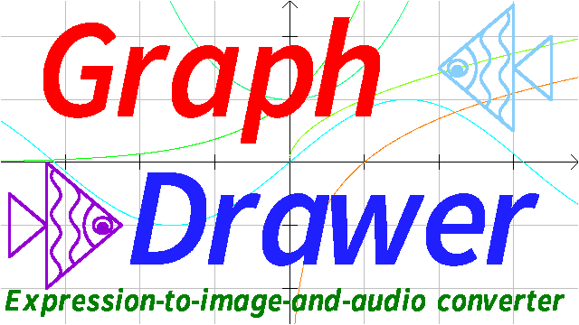

# Graph Drawer

This is a product able to parse expresions and generate image and audio, with two backend libraries, an expression evaluator and a graph drawing library.

## Expression Evaluator: libexpr,libexpr-lc

The libexpr is freestanding library able to parse and eval the input expression and return the result to the caller, without libc.
The libexpr-lc provides the constants the standard libc functions such as e,pi,sin(),exp(), but libc is required by libexpr-lc.
- Can add custom variable,constant and function.
- Can use custom memory allocator.
Suitable for:
- Parse expression once with eval many times.
- Requires branch and loop in expression.
Not suitable for:
- Parse simple expression once with eval only several times.
The expression evaluator behaves worse than [tinyexpr](https://github.com/codeplea/tinyexpr/blob/master/README.md) in the cases like this. See the below.


## Graph drawing library: libgraph

The libgraph is able to generate the image of a function . But it supports only .bmp format now. libc is required by libgraph.

## Build guide

```
cmake -B build -DCMAKE_BUILD_TYPE=Release
cd build
make or ninja
```

## Example

draw a graph of sin(t) to 1.bmp:
```
./draw -o 1.bmp 'sin(t)'
```

output the sum from 1 to 100:
```
./calc 'sum(n,1,100,1,n)'
```

generate a 1s 440Hz sound .wav file:
```
./wave 'sin(440*2*pi*t)' -c 1 -o 1.wav
```

An example of API of graph-drawer expr:
```C
#define _GNU_SOURCE
#include <stdio.h>
#include <stdlib.h>
#include <assert.h>
#include "expr.h"
expr_globals_define();
int main(void){
	struct expr *ep;
	ep=expr_new2("t+1","t");
	assert(ep);
	printf("result:%lf\n",expr_eval(ep,2.0));
	expr_free(ep);
	return EXIT_SUCCESS;
}
```

Add custom variable and function:
```C
#define _GNU_SOURCE
#include <stdio.h>
#include <stdlib.h>
#include <assert.h>
#include "expr.h"
expr_globals_define();
double mul3add1(double x){
	return x*3.0+1.0;
}
int main(void){
	struct expr *ep;
	struct expr_symset *esp;
	volatile double x0=4.0;
	esp=expr_symset_new();
	assert(esp);
	assert(expr_symset_add(esp,"x0",EXPR_VARIABLE,0,&x0));
	assert(expr_symset_add(esp,"f",EXPR_FUNCTION,0,mul3add1));
	ep=expr_new4("t+1+x0+f(x0)","t",esp,0);
	assert(ep);
	printf("x0=%lf,result:%lf\n",x0,expr_eval(ep,2.0));
	x0=2.0;
	printf("x0=%lf,result:%lf\n",x0,expr_eval(ep,2.0));
	expr_free(ep);
	expr_symset_free(esp);
	return EXIT_SUCCESS;
}
```

## Speed
720%-2870% slower than native C.

## Compare with other expr libs

||zserge expr|tinyexpr|graph-drawer expr|
|:---:|:---:|:---:|:---:|
|Data type|float|double|double|
|Initialize speed|Medium 2.3x|Fast 7.8x|Slow 1.0x|
|Memory cost|Medium 2.3x|Low 1.0x|High 41.7x|
|bitwise and/or/xor support|Cast to integer|No|Yes|
|Number parse|Digit accumulate|Digit accumulate|Pseudo strtod|
|Number parse speed|Fast-Medium|Fast|Slow|
|Number parse cache|No|No|Yes(but still slower than other two)|
|libc required|Yes|Yes|No for core. But builtin symbols and frontend needs.|
|Core arch independence|Yes|Yes|x86/arm64 for mem* and syscall|
|Non-unix support|Untested|Untested(the author tested Yes)|Yes(\*.exe in Release)|
|User variable defined in code|Yes|Yes|Yes|
|User variable defined in expr|Yes(Auto)|No|Yes(value--\>a/a=:value/var(a,[value]))|
|Allow write variables in expr|Yes(=)|No|Yes(--\>,-\>)|
|User constant|No|No(only zero args pure function)|Yes|
|Active|No (Latest 2017-12-3)|Yes|Yes|
|Amount of bugs|Few-Medium|Few|Many|
|Size|Lightweight|Lightweight|Bloated|
|Allow unsafe mode|No|No|Yes|
|Gnu extension required|No (C99)|No (C99)|Yes|
|Power operator|\*\*|^|\*\*|
|Amount of file|Single header file|Single .c file+header|Multi-file|
|Hot function|Yes|No|Yes|
|Optimize|No|Yes|Yes|
|Symbol system|struct expr\_var\_list(one-next list)/struct expr\_func(array)|te\_variable(array)|struct expr\_symset(multi-next list)/struct expr\_builtin\_symbol(array)|
|Symbol create API|expr\_var()|No|expr\_symset\_add()|
|Eval API|expr\_eval()|te\_eval()|expr\_eval()|
|One-shot API|No|te\_interp()|expr\_calc()|
|Custom memory allocator|Yes(global variable required,patch before header)|Yes(global variable required,patch before header)|Yes(global+non-global)|
|MT-safe for same object|Yes(except = and context)|Yes|No(an object only for one thread)|
|Reuseability|No(allocate/free require global variable)|No(similarly)|Yes(\*\_r)|
|JIT support|Yes|No|No|
|Branch and loop|No|No|Yes|
|Syscall support|No|No|Yes|
|AST|Yes|Yes|No|
|Project type|standalone library|standalone library|backend library of graph-drawer|
|Bugfix speed|Unactive|Fast|Slow|
|Code readability|Clear|Clear|Chaos|
|Build system|make|make|cmake|
|Start date|07-08-2016|01-21-2016|02-19-2024|
|Amount of API functions|4|4|\>180|
|Popularity|Medium|High|Low|
|License|MIT|Zlib|GPL v3+|
